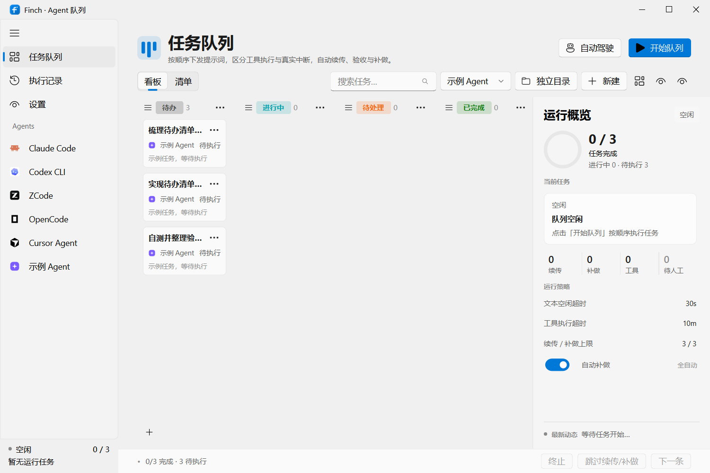
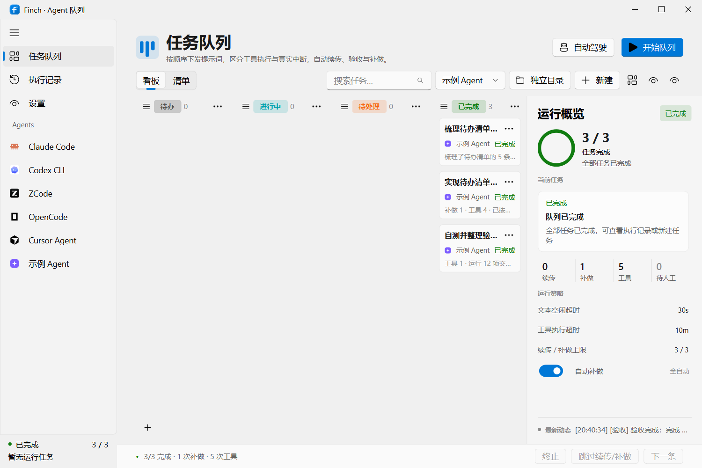
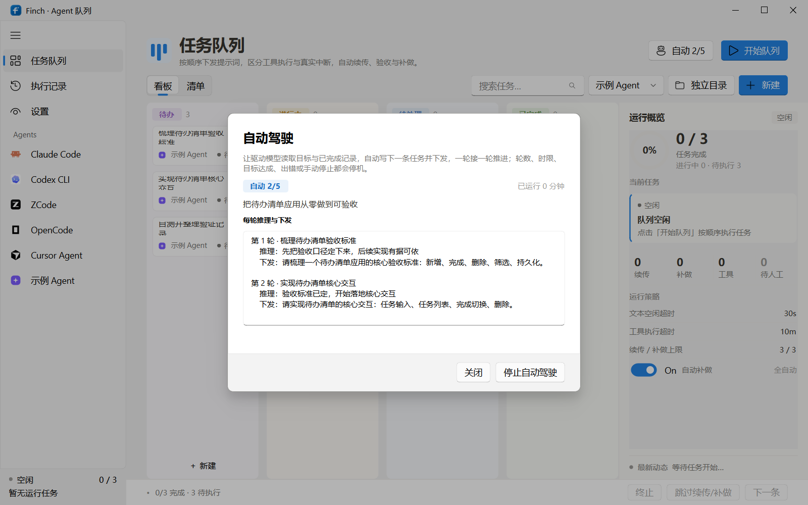
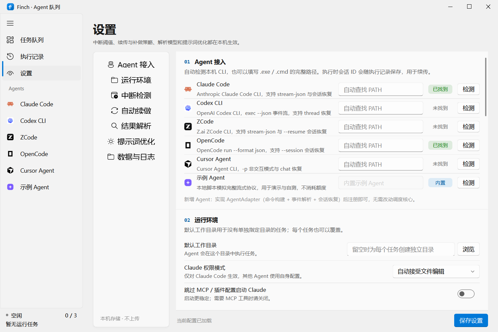
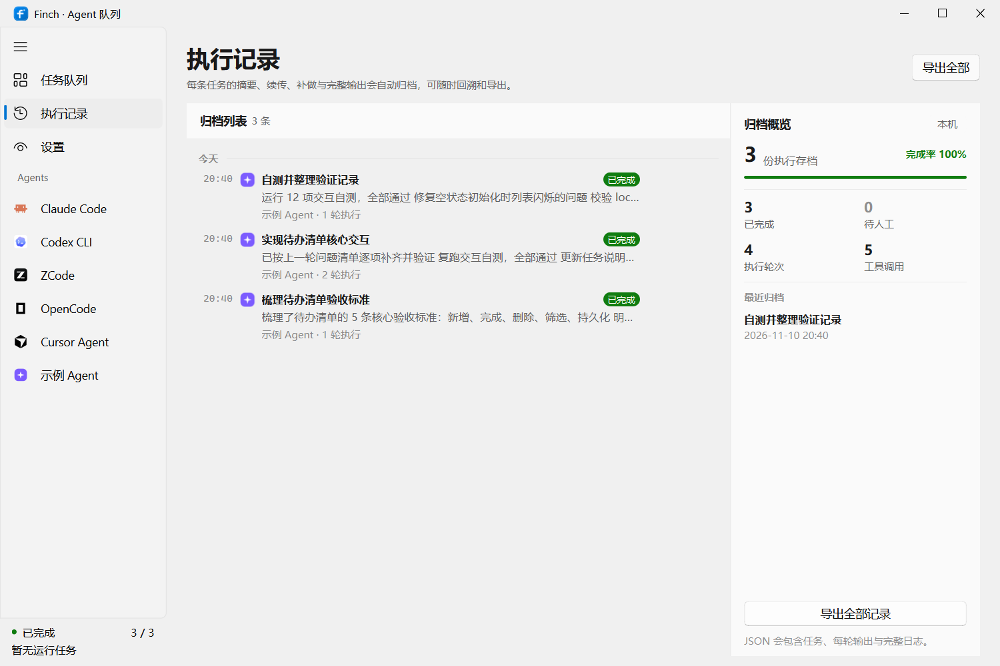
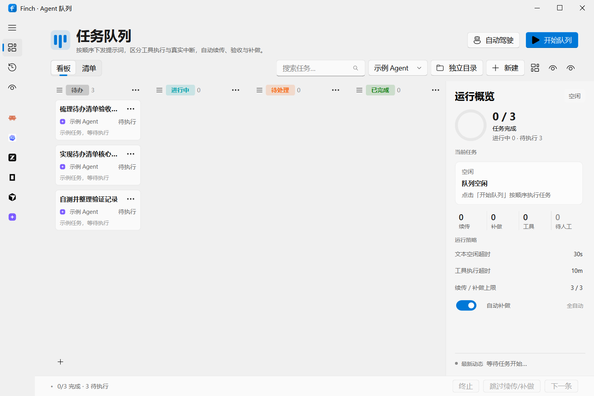

# Finch

本地 AI Coding Agent 链式任务调度与监督工具。把多条主提示词排成队列，Finch 负责下发、监听、区分「工具执行中」与真实中断、自动续传、验收缺漏、自动补做，直到任务真正落地再进入下一条。

界面直接使用 Fluent 桌面组件库，不再自绘控件：无边框窗口 + Mica 背景、Fluent 标题栏、可折叠 NavigationView 导航（含 Agents 分区）、分段标签、搜索框、下拉框、开关、消息框与提示条都来自 [PyQt-Fluent-Widgets](https://github.com/zhiyiYo/PyQt-Fluent-Widgets)（GPL-3.0）与 [PyQt6-Frameless-Window](https://github.com/zhiyiYo/PyQt6-Frameless-Window)（GPL-3.0），动效沿用 Fluent 2 规范（时长 100/200/300ms、OutCubic 缓动）。配色同样取自库：主色用 Fluent 的 `DEFAULT_BLUE`，强调色阶来自 `ThemeColor.PRIMARY / DARK_1 / LIGHT_1…`，语义色用 `FluentThemeColor`（绿 / 橙 / 红 / 紫 / 青），中性色（正文 0.896、次级 0.6063、禁用 0.43、描边 0.06 等）直接从库自己的样式表里读出，不再自挑色值。队列页在 Fluent 骨架上是 Notion 式看板：页面图标 + 大标题、看板 / 清单双视图，四列看板（待办 / 进行中 / 待处理 / 已完成）用彩色状态标签与计数，卡片为 Fluent 圆角卡片。应用图标为自行重绘的 Finch 渐变标记。



## 核心能力

- **看板 / 清单双视图**：四列看板按状态实时归位（待办 / 进行中 / 待处理 / 已完成），待办列支持拖拽排序；一键切回清单视图查看完整上下文。
- **任务队列**：新建、编辑、拖拽排序；主任务下缩进展示每次「续传 / 补做」子任务、触发原因与结果。
- **多 Agent 适配**：Claude Code、Codex、ZCode、OpenCode、Cursor Agent，以及内置示例 Agent。新增 Agent 只需实现适配层，不改调度核心。
- **智能中断检测**：工具执行期间豁免普通超时，只受独立的工具超长阈值约束；工具结束自动恢复文本超时检测。
- **自动续传**：识别文本空闲超时、工具超时、网络异常、进程异常、回复结构不完整，保留原会话自动续写；达到上限标记「待人工」并弹窗。
- **结果验收**：优先调用 OpenAI 兼容大模型提取「摘要 / 已完成 / 未完成 / 问题与风险」，未配置时自动回退关键词与正则规则。
- **自动补做**：根据原任务与缺漏清单生成补做提示词，可先经 prompt-optimizer 优化；支持全自动或人工确认后下发。
- **自动驾驶**：设定目标与轮数上限后，驱动模型读取目标与已完成记录，自动写出下一步任务并下发，一轮接一轮推进；轮数、时限、目标达成、出错或手动停止都会停机，每轮推理与下发内容可在面板中查看，中断后重启可继续。
- **提示词优化**：每条任务可一键优化用户提示词或系统提示词，支持替换原文、另存为新任务。优先走 prompt-optimizer MCP，失败回退内置优化模型。
- **断点续跑**：队列、会话 ID、执行记录持久化到 SQLite；程序关闭/崩溃后可从原会话继续。
- **归档与导出**：完整输出、工具记录、中断记录、补做历史、日志按任务归档；支持复制、单任务导出与全量历史导出。

## 截图

| 看板视图 | 执行完成 |
| --- | --- |
|  |  |

| 自动驾驶运行中 | 设置 |
| --- | --- |
|  |  |

| 执行记录归档 | 折叠导航 |
| --- | --- |
|  |  |

## 快速开始

要求 Windows 10/11、Python 3.11+（开发验证使用 3.13）。

1. 双击 `install.bat` 安装独立 venv 依赖（含 Fluent 组件库与无边框窗口库）。
2. 双击 `启动 Finch.bat` 启动。
3. 首次启动会载入 3 条示例任务（内置示例 Agent，不消耗任何额度）。点击「开始队列」可观察完整的执行 → 补做 → 再验收闭环。
4. 在「设置」中配置真实 Agent 路径/默认工作目录，再把任务切换为对应 Agent。

也可以命令行启动：

```bat
.venv\Scripts\python.exe run.py
```

测试时可用 `FINCH_HOME` 指定独立数据目录，避免污染正式数据：

```bat
set FINCH_HOME=F:\temp\finch-test
.venv\Scripts\python.exe run.py
```

## 使用流程

1. 在顶部选择默认 Agent 与工作目录（每个任务可以单独覆盖）。
2. 「新建任务」填写标题与主提示词，按需调整 Agent 与工作目录。
3. 拖动左侧六个点排序；点击「开始队列」。
4. 执行中可暂停（当前任务结束后暂停）、终止、跳过当前任务的续传/补做、强制进入下一条。
5. 点击任务行查看「摘要 / 执行记录 / 完整日志」；未完成项与问题可人工修正。
6. 如果开启「补做前人工确认」，任务会进入「待确认」，在详情里编辑补做提示词后下发或跳过。
7. 完成后任务自动归档到「执行记录」，可导出 JSON（含完整日志）。

看板与清单是两个视图，同一份队列：看板按状态分四列（待办 / 进行中 / 待处理 / 已完成），待办列可拖拽排序；点侧栏的 Agent 可只看某个 Agent 的任务，工具栏搜索框按标题与提示词过滤。

### 看板交互

- **拖动列**：按住列头左侧的把手把整列拖到别的位置，落点按光标所在半侧插入。
- **调整列宽**：拖动列右侧的竖条，宽度按 8px 步进，并在 160 / 200 / 240 / 280 / 320 处磁吸；双击竖条恢复默认。
- **横向 / 纵向**：工具栏「纵向排列」在两种排布间切换，纵向时列按内容高度堆叠，整块看板滚动。
- **隐藏 / 恢复列**：列头右侧「⋯」可隐藏该列，工具栏「列设置」可把隐藏的列重新显示；列顺序、宽度、隐藏状态与排列方向都会记住。
- **概览面板**：右侧「运行概览」可用工具栏「概览面板」折叠，折叠后看板占满宽度。

## 自动驾驶

点队列页右上角「自动驾驶」打开面板：

- **目标（可选）**：写清楚要达成什么，达成后自动停；不填就只看轮数。
- **最多轮数 / 时限**：两个停止条件可叠加，`最多 5 轮 + 填个目标` = 最多 5 轮，做完提前收工。
- **自动验收 / 自动确认补做**：打开后自动驾驶会直接确认补做，不再停下来等人。

启动前会弹一次确认（它会以你的身份自动下发任务）。运行中：

- 队列跑空后，驱动模型读取「目标 + 已完成记录 + 当前队列」，写下下一步任务并自动入队执行，直到目标达成、轮数用尽、时间到、出错或你点停。
- 面板里可以看到每一轮的推理与最终下发的提示词；顶栏按钮显示当前轮次（`自动 2/5`）。
- 进度写入 `data/autopilot.json`，应用崩溃或被关闭后重启，可点「继续自动」从中断处接着跑。

驱动模型复用「结果解析模型」通道（设置 → 结果解析），未配置时自动驾驶只能跑完已有队列，无法生成下一步。

## 状态机

```
待执行 → 执行中 ⇄ 工具执行中
              ↘ 中断 → 续传中 → 执行中 …
              ↘ 校验中 → 已完成
                     ↘ 补做中 → 校验中 …
                     ↘ 待确认（人工确认补做）
异常：失败 / 待人工（达到续传或补做上限）/ 已终止 / 已跳过
```

- 每次续传或补做都是独立子任务（`resume` / `followup` run），保留提示词、输出、工具记录、中断原因和耗时。
- 关闭应用时正在执行的任务会保存为「中断」，下次启动队列时自动从原会话继续；待确认的补做也会保留，重启后仍可下发或跳过。

## 中断判定规则

| 阶段 | 判定 | 默认阈值 |
| --- | --- | --- |
| 工具 / 命令执行 | 捕获到原生 tool_use / tool_call / command_execution 事件，或检测到子进程活动 | 工具连续无进度 600s |
| 纯文本 / 代码输出 | 无新内容且未收到结束标记 | 30s |
| 首包 | 启动后等待首个输出 | 90s（可调） |
| 网络 | stderr / 重试事件出现连接断开、超时、5xx 等 | 超时或进程异常时归类 |
| 回复完整性 | 代码块未闭合、结尾截断、括号未闭合、异常退出子类型等 | 命中即视为不完整 |

工具执行期间普通文本超时暂停计时；工具返回结果后自动切回。文本超时、工具超时均可在「设置 → 中断检测与续传」修改。

## Agent 适配与验证状态

| Agent | 接入命令 | 本机状态 |
| --- | --- | --- |
| Claude Code | `claude -p --output-format stream-json --verbose --include-partial-messages`，`--resume` 续传，stdin 下发提示词 | 已找到 CLI；已用真实 stream-json 事件（含 retry/result/error）验证解析。本机 Claude 账号当前返回 401（第三方网关鉴权），未能在本机完成一次真实编码闭环 |
| Codex CLI | `codex exec --json --skip-git-repo-check --full-auto`，`codex exec resume <thread_id>` | 未安装，按官方 exec JSONL 协议实现，未实机验证 |
| ZCode | `zcode --prompt … --output-format stream-json --cwd …`，`--resume` | 未安装，按官方 CLI 文档实现（兼容 Claude 风格事件），未实机验证 |
| OpenCode | `opencode run --format json`，`--session` 续传 | 已用真实 OpenCode CLI 跑通 Finch 调度：能启动进程、拿到 session ID、解析 JSON 错误事件并正确落为「失败」；本机所有 provider 凭据均返回 401，未生成成功内容 |
| Cursor Agent | `cursor-agent --print --output-format stream-json --force`，`--resume` | 未安装 `cursor-agent`；按 Cursor CLI 文档（tool_call started/completed）实现，未实机验证 |
| 示例 Agent | 内置 Python 流式脚本 | 已完整体验证：正常、文本超时、工具超时、补做、确认、上限、暂停/终止/下一条、重启恢复 |

> 验证不含糊：调度内核与事件解析均有自动化测试；真实 Claude/Codex/ZCode/OpenCode/Cursor 的成功闭环依赖你本机 CLI 的安装与登录状态。首次配置后建议先跑一条低风险任务确认。

### 新增 Agent

实现 `finch/agents/base.py` 中 `AgentAdapter` 的：

- `_args(request)`：构建命令（是否通过 stdin 下发由 `stdin_prompt` 决定）
- `create_parser()`：把 CLI 的流事件转成 `init / text / thinking / tool_start / tool_update / tool_end / retry / error / result` 标准事件
- 在 `finch/agents/__init__.py` 的 `ADAPTER_CLASSES` 注册

调度、中断检测、续传、验收与 UI 无需改动。参考实现见 `claude.py`、`codex.py`、`cursor.py`、`opencode.py`、`zcode.py`。

## prompt-optimizer 接入

Finch 通过 MCP Streamable HTTP 调用 [prompt-optimizer](https://github.com/linshenkx/prompt-optimizer) 的 `optimize-user-prompt` / `optimize-system-prompt`，默认地址 `http://localhost:8081/mcp`。

```bash
docker run -d -p 8081:80 \
  -e VITE_OPENAI_API_KEY=your-key \
  -e MCP_DEFAULT_MODEL_PROVIDER=openai \
  --name prompt-optimizer \
  linshen/prompt-optimizer
```

然后在「设置 → 提示词优化」选择「自动（MCP 优先，失败回退内置）」并点击「测试 MCP」。没有 MCP 时，可开启「使用独立的优化模型」填入任意 OpenAI 兼容接口；两者都不可用时，优化会报错而不会阻塞任务执行。

## 结果解析模型

在「设置 → 结果解析模型」填入 OpenAI 兼容 Base URL、API Key 和模型名即可启用语义提取。请求采用 `/chat/completions`，要求模型输出 JSON。未启用或调用失败时自动回退规则识别。

人工在详情中「修正」识别结果时，可将修正保存为反馈示例，后续大模型识别会参考最近几条修正。密钥仅保存在本机 `finch.db`（明文），请在受控机器上使用。

## 数据与导出

- 数据目录：`%APPDATA%\Finch`（日志在 `logs`，SQLite 在 `data\finch.db`），可用 `FINCH_HOME` 覆盖。
- 单任务导出：详情 → 导出，JSON 含任务、每次 run、中断/工具记录和完整日志。
- 全量导出：「执行记录」→ 导出全部。
- 历史归档包含已完成、失败、待人工、已终止等所有终态任务。

## 项目结构

```
finch/
  agents/         Agent 适配层（命令构建、事件解析、会话续传）
  core/
    detector.py   工具/文本分层中断状态机
    engine.py     队列调度、续传、补做、进程与日志
    analyzer.py   规则 + LLM 结果验收
    optimizer.py  prompt-optimizer MCP / 内置优化
    prompts.py    续做提示词模板
  ui/             PyQt6 界面（看板、清单、详情、设置、历史、编辑器、自动驾驶面板）
  store.py        SQLite 持久化
  config.py       配置与默认阈值
tests/            68 个测试（后端/集成 58 + UI 10）+ Fake LLM/MCP 服务
scripts/          离屏 UI 截图与状态验证脚本
```

## 测试

```bat
.venv\Scripts\python.exe -m unittest tests.test_adapters tests.test_analysis_optimizer tests.test_autopilot tests.test_detector tests.test_engine tests.test_mock_agent_encoding tests.test_parsers tests.test_store -v
.venv\Scripts\python.exe -m unittest tests.test_ui -v
```

覆盖：中断判定、工具豁免、回复不完整、网络异常、规则/LLM 解析、MCP JSON/SSE 协议、Claude/Codex/Cursor/OpenCode/ZCode 命令构造与事件解析、队列补做/补做上限/关闭自动补做、文本/工具超时续传、续传上限、人工确认/跳过、暂停/终止/下一条/重置、重启恢复、持久化 CRUD/归档/导出、侧栏折叠、Agent 过滤、看板分列与拖拽排序、自动驾驶（生成下一轮/轮数上限/目标达成停机/中断恢复）、详情标签、任务编辑/修正、设置保存、历史与任务导出、UI 启动真实示例 Agent 进程。UI 测试使用离屏窗口与独立 FINCH_HOME，不操作正式数据或桌面窗口。

## 已知限制

- 一次只跑一条队列、一个 Agent 进程；并行任务未实现。
- 真实 Agent 的成功执行取决于本机 CLI 登录与 provider 连通性；上表已标注未实机验证的适配器。
- 中断后的「续传」依赖 Agent 支持会话恢复；拿不到 session ID 时会直接转「待人工」。
- 设置中的续传指令优化（`optimize_continue`）默认关闭，可在「自动续做」中开启；补做提示词优化默认开启，但需要 MCP 或内置优化模型可用。
- 回复完整性采用结构启发式 + 结果 subtype；语义级验收交给结果解析模型。
- 提示词优化与语义解析都需要外部模型/服务，Finch 不内置模型额度。
- 当前仅提供 Windows 启动脚本；代码本身使用跨平台路径与进程接口，但 macOS/Linux 未实测。

## 参考与原创说明

- 界面组件与动效直接复用开源实现：[PyQt-Fluent-Widgets](https://github.com/zhiyiYo/PyQt-Fluent-Widgets)（Fluent 控件、NavigationView 导航、消息框、图标，GPL-3.0）与 [PyQt6-Frameless-Window](https://github.com/zhiyiYo/PyQt6-Frameless-Window)（无边框窗口、Mica/Acrylic，GPL-3.0）。这两个库为 GPL-3.0，分发 Finch 时需遵循 GPL 要求。
- 看板的信息架构参考 [Notion](https://www.notion.so)（页面标题、彩色状态列、卡片列表），非像素级复刻。
- 自动驾驶（目标 + 轮数 + 时限，驱动模型写下一步并下发）的交互与停机条件参考 [dsh-one-click-polish](https://github.com/HTRP1486/dsh-one-click-polish) 的 Autopilot；Finch 的实现是独立编写：调度在本地引擎内完成，驱动模型复用「结果解析模型」通道。
- 早期列表页参考 [magpie](https://github.com/yetone/magpie)。
- 提示词优化接口参考 [prompt-optimizer](https://github.com/linshenkx/prompt-optimizer) 的 MCP 工具定义。
- 多 Agent CLI 事件协议参考 Claude Code stream-json、OpenAI Codex `exec --json`、Cursor Agent CLI output-format 文档；队列编排思路参考了 [CodeyBox](https://github.com/AdamFrisby/CodeyBox)、[axel](https://github.com/txtx/axel) 等开源项目的通用做法。
- Agent 品牌图标取自 magpie 仓库的 `internal/gui/assets/icons/`，仅用于本地界面展示，商标归各 Agent 所属方所有。
- 本项目调度状态机、续传/补做闭环、分层中断检测、PyQt6 界面与全部代码为原创实现，未复制上述项目代码。

## 许可证

本仓库代码以 [MIT](LICENSE) 协议开源，版权属于 cv-superding。

第三方组件各自遵循其原有协议：界面层依赖 [PyQt-Fluent-Widgets](https://github.com/zhiyiYo/PyQt-Fluent-Widgets) 与 [PyQt6-Frameless-Window](https://github.com/zhiyiYo/PyQt6-Frameless-Window)，二者均为 **GPL-3.0**；Qt 运行库遵循 LGPL-3.0。MIT 仅覆盖 Finch 自身代码，若分发包含上述 GPL 组件的完整程序，整体需按 GPL-3.0 的要求提供完整对应源码并保留版权声明。
